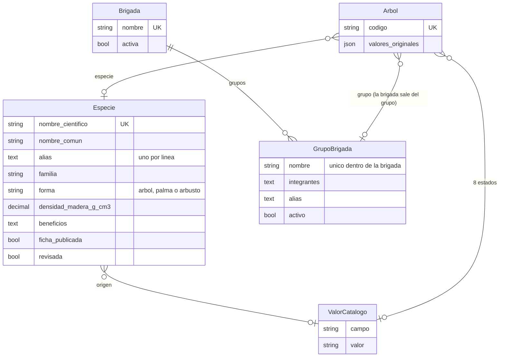

# BE-014 — Separar la BD: especies (con CRUD), estados del catálogo, brigadas, fotos, mediciones y estimaciones de CO₂

**Estado:** PENDIENTE (escrito el 11/10/2026 por el ASESOR «granate»)
**Prioridad:** esta noche, por decisión de Cristhian (11/10, 17:00), **con punto de corte**: lo que no esté mergeado con el CI en verde y probado en la PC a la hora de corte, **lunes 12/10, 23:59** (Cristhian, 11/10 18:57), pasa a M2 sin tocar `main`.
**Presupuesto:** L, en **2 PR** (el PR 2 solo arranca con el PR 1 mergeado).
**Pasadas máx.:** 2 por PR
**Herramienta:** Claude Code (Cristhian)
**Agente:** orquestador ORQ-CA en una **sesión nueva** (abierta **dentro** de `backend-MAN.OGG`). Despacha `api-mvc`. La QA la hace `qa-revisor`, con contexto limpio.
**Ramas:** `ticket/BE-014-especies-catalogo-brigadas` (PR 1) y `ticket/BE-014-fotos-mediciones-co2` (PR 2)
**Canario:** sesión ORQ-CA «komatiita»; ticket «diatomita»
**Issue:** #34 (Refs en el PR 1, Closes en el PR 2)
**Condición previa:** **BE-012, BE-013 y BE-016 mergeados** (BE-016 lo hace la misma sesión, antes). Se verifica con `git ls-remote` antes de crear cada rama.
**Aprobación:** Risc; si no está, bypass de admin con el CI en verde y la razón en el PR.

## Regla de oro: el contrato NO cambia
La API sigue entregando exactamente los mismos campos con la misma forma (`nombre_comun`, `nombre_cientifico`, `origen`, `dap_cm`, `co2_almacenado_kg`, `foto_url`, `ficha_especie`…): **los serializers aplanan** las tablas nuevas. `validar_contrato.py` y los tests del API que validan contra el contrato tienen que seguir en verde **sin tocar `contrato/`**. El front no se toca.

## Por qué (pedido de Cristhian)
Hoy `Arbol` es una tabla plana. Hay datos que son de la especie y no del árbol (origen, ficha), estados que se escriben a mano, brigadas con varios nombres, una sola foto y una sola medida sin historia, y un CO₂ sin método ni fecha.

## PR 1 — Especies, estados del catálogo y brigadas
1. **`Especie`** (con historial). **CRUD en el panel:** Administrador lo hace todo; Editor agrega, edita y ve.
   - Campos: `nombre_cientifico` (único), `nombre_comun`, `alias` (uno por línea), `familia`, `origen` (FK al catálogo de `origen`), `forma` (árbol / palma / arbusto; constantes), `densidad_madera_g_cm3` (opcional, con su `fuente_densidad`).
   - Además, **los campos de `FichaEspecie`**: `beneficios`, `dato_curioso`, `cuidados`, `fuente_ficha` y `ficha_publicada`. La ficha se publica solo con el OK del stakeholder.
   - **`FichaEspecie` desaparece:** una migración de datos pasa las 3 fichas a sus especies, con su historial y sin publicar.
   - El servicio de cápsulas lee la ficha desde `Especie`.
2. **`Arbol.especie`** (FK, opcional; sin especie → «en revisión» por la regla de BE-012).
   - Una migración de datos busca la especie de cada árbol por nombre normalizado o por alias (como las cápsulas).
   - **Nunca se inventa una especie.** Si un nombre no tiene especie, se crea una con ese nombre tal cual y queda «por revisar» en el panel (`revisada = false`), o el árbol queda sin especie y en revisión. El agente propone cuál de las dos en el plan.
   - El texto original de la planilla se guarda en `valores_originales` (JSON del árbol).
   - **Flujo en la ingesta (pedido de Cristhian, 11/10 18:10: «que al momento de la ingesta se acomode al nombre de la especie»):** el nombre de la planilla se busca normalizado (sin mayúsculas, tildes ni espacios de más) en `nombre_cientifico`, `alias` y `nombre_comun` de las especies. Si coincide con una sola, el árbol queda con esa especie y el nombre canónico. Si no coincide o coincide con varias, el árbol va **en revisión** con el motivo «Especie no registrada: …». En la pantalla de revisión de BE-013 se elige la especie de una lista o se agrega el texto como alias de una existente; la especie nueva se crea en su CRUD.
   - Alias iniciales (la migración de datos los siembra): «Schinus» y «Schinus Molle» → *Schinus molle*; «Roystonea» → *Roystonea regia*; «Prosopis Pallida» → *Prosopis pallida*. Lo que pase por un alias queda anotado en `valores_originales`.
   - **`origen` pasa a la especie.** Si los árboles de una misma especie traen orígenes distintos, se informa y se resuelve a mano.
3. **Los 9 estados como FK a `ValorCatalogo`** (`tipo_individuo`, `identificacion`, `condicion_conservacion`, `estado_general`, `estado_copa`, `tronco_danos`, `raices_base`, `interferencia_entorno`; `origen` ya va por la especie), con `limit_choices_to` por campo.
   - La migración de datos mapea el texto normalizado.
   - Si un valor no está en el catálogo, la FK queda en `null`, el texto se guarda en `valores_originales` y el árbol va **en revisión** con el motivo.
   - La vista «Valores fuera del catálogo» pasa a leer `valores_originales`.
4. **`Brigada` y sus grupos** (decisión de Cristhian, 17:35: «todo es una sola brigada; brigada es una tabla independiente con grupos y su CRUD para agregar brigadas y grupos»):
   - `Brigada` (con historial): `nombre` (único), `activa`.
   - `GrupoBrigada` (con historial): `brigada` (FK), `nombre` (único dentro de la brigada), `integrantes` (uno por línea), `alias` (otros nombres con que llega en la planilla), `activo`.
   - `Arbol.grupo` (FK a `GrupoBrigada`, opcional); la brigada del árbol sale de su grupo. La regla de BE-012 exige grupo en los árboles de campo (no en los de ejemplo).
   - CRUD de brigadas y grupos en el panel (grupos como *inline* de la brigada): Administrador todo; Editor agrega, edita y ve.
   - Migración de datos: «Brigada A» con los grupos «Sopita», «zapatito» y «zapato» (los nombres tal como vienen en la planilla del stakeholder). El grupo de cada árbol del S01 se carga reimportando `arb3-S01-34.xlsx`, que trae la columna «Grupo».
   - Planilla: la columna «Brigada» se resuelve a la brigada y «Grupo» al grupo (por nombre o alias). Si «Brigada» trae el nombre de un grupo conocido (como en la planilla original), se resuelve a ese grupo. Lo que no se resuelve va a `valores_originales` y a revisión.
5. **Importador y carga web** (BE-012/BE-013): el texto de la planilla se resuelve a especie, valor del catálogo y brigada. Lo que no se resuelve queda en `valores_originales` y en revisión. **En la pantalla de revisión de BE-013**, el campo de especie ofrece las especies existentes; crear una especie nueva se hace desde el CRUD.
6. `cargar_demo`, `completar_ejemplo` y `cargar_capsulas` se adaptan a las tablas nuevas. **Los resultados de la BD local no cambian:** 34 + 73 publicados y 0 en revisión.

## PR 2 — Fotos, mediciones y estimaciones de CO₂
1. **`Medicion`** (con historial): `arbol`, `fecha`, `brigada` (FK), `altura_total_m`, `dap_cm`, `copa_ns_m`, `copa_eo_m`, `simulada` (bool).
   - La cartilla, la regla y la lista usan **la medición más reciente** (por fecha y, si empatan, por id), traída con `Subquery`/`Prefetch` y sin N+1.
   - Una migración de datos crea una medición por árbol con las columnas de hoy y después **las quita de `Arbol`**.
   - El importador crea una medición nueva solo si cambia algún valor (es idempotente).
2. **`EstimacionCO2`** (con historial): `arbol`, `almacenado_kg`, `captura_anual_kg`, `metodo` (texto obligatorio), `fecha`, `autor` (texto: «stakeholder»), `simulada` (bool). La cartilla usa la más reciente.
   - Migración de datos: `simulada` = el `co2_simulado` de BE-015, con el método que trae la `fuente` (o el de la hoja `Parametros_CO2` para el S01).
   - **Regla (cambió el 11/10, 17:22):** un árbol real también puede tener CO₂ simulado; un árbol `demo` solo puede tener estimaciones simuladas. La API sigue entregando `co2_simulado` (contrato 0.5.0) desde la estimación vigente.
3. **`Foto`**: `arbol`, `tipo` (principal / detalle), `archivo` (ruta relativa; **los archivos no entran al repo**), `fecha`, `autor`, `orden`.
   - `foto_url` y `foto_miniatura_url` del contrato salen de la principal, con la misma regla de hoy (hoy todas van en `null`).
   - Se migran `foto_archivo` y `foto_detalle_archivo` y se quitan de `Arbol`.
   - Subir fotos sigue en M2 (BE-007).
4. **Panel:** mediciones, estimaciones y fotos como *inlines* del árbol, de solo lectura salvo para el Administrador, con historial.
5. La regla de calidad (BE-012) pasa a leer la medición y la estimación vigentes. Los motivos no cambian de texto.

## Rendimiento y migraciones
- La lista del sector y la cartilla, con **un número de consultas fijo** (test con `django_assert_max_num_queries`).
- Cada migración de datos es **reversible** o, si no puede serlo, lo dice en el PR.
- **Antes de migrar la BD de Cristhian:** `pg_dump` y su OK.
- Las migraciones se prueban también sobre una copia restaurada del respaldo.

## Archivos permitidos (los dos PR)
- `apps/censo/models.py`, migraciones nuevas en `apps/censo/migrations/`, `apps/censo/admin.py`, `apps/censo/admin_capsulas.py`, `apps/censo/admin_carga.py`, `apps/censo/selectores.py`, `apps/censo/api/serializers.py`, `apps/censo/api/views.py`
- todos los archivos de `apps/censo/servicios/` y `apps/censo/management/commands/`, y las plantillas de `apps/censo/templates/admin/censo/**`
- nuevo opcional: `apps/censo/admin_catalogos.py` (CRUD de especie y brigada, si `admin.py` pasa de ~300 líneas)
- `config/constantes.py` (solo se **agregan** constantes, o se mueven las que dejan de usarse, avisándolo en el PR)
- `tests/censo/**`
- `README.md` (sección del panel y de los comandos), `docs/ARQUITECTURA.md` (el modelo de datos nuevo), `docs/ESTADO.md`, `docs/CANARIOS.md`, `docs/tickets/BE-014.md`
- **Prohibido:** `contrato/**`. Nada más sin preguntar.

## Criterios de aceptación
1. **PR 1:**
   - CRUD de especie y brigada por rol;
   - la ficha sale desde `Especie`, igual que antes;
   - mapeo por alias;
   - un nombre sin especie no inventa nada;
   - un estado fuera del catálogo queda en `valores_originales` y en revisión;
   - la vista «Valores fuera del catálogo» funciona;
   - el importador y la carga web resuelven las FK.
2. **PR 2:**
   - la medición y la estimación más recientes son las que salen;
   - el importador no duplica mediciones;
   - CO₂ simulado solo en `demo`;
   - las fotos salen de la principal;
   - el número de consultas es fijo.
3. En los dos: `pytest`, `ruff` y `validar_contrato.py` en verde **sin cambios en `contrato/`**, y el CI en verde. Para mirarlo: `mog-ci-back`.
4. **Prueba en la PC** después de cada PR (con respaldo): las respuestas de la API, comparadas por script **antes y después** de migrar, para el S01 (34), los otros sectores (73), `S01-A001`, `S02-D002` y la lista de cada sector, son **idénticas**, salvo el orden de las claves. En el panel, 0 en revisión.
5. `git diff --stat main` de cada PR solo toca sus «Archivos permitidos».
6. Commits `[BE-014] …` sin firmas. El agente pregunta antes de cada `git push` y no mergea.
7. El resumen de ≤10 líneas queda en `docs/tickets/BE-014.md`, con el diagrama del modelo nuevo (texto o Mermaid), «Hice fuera de lo pedido», `Consumo:` y la línea del canario del ticket.

## Fuera de alcance
Cambios del contrato o del front (mostrar el historial de mediciones o varias fotos en la web es M2), subir fotos (BE-007), el admin en React (M2) y calcular el CO₂ (lo hace el stakeholder).

## Modelo de datos nuevo (PR 1)

`FichaEspecie` desaparece (sus campos viven en `Especie`). `Arbol` ya no guarda `nombre_comun`, `nombre_cientifico`, `origen` ni `brigada`: salen de la especie y del grupo; el texto que no se pudo resolver queda en `valores_originales`.

## Resumen
PR 1 (el PR 2, fotos, mediciones y CO₂, pasa a M2).
- `Especie` (con ficha y alias), `Brigada` y `GrupoBrigada` en `models_catalogos.py`; `Arbol` pasa a `especie`, `grupo`, `valores_originales` y 8 estados como FK al catálogo. `FichaEspecie` desaparece. Migraciones 0010–0013, reversibles, con el historial de la ficha y del árbol.
- La API no cambia: `contrato/` sin diff; los serializers aplanan. El grupo es opcional y nunca manda a revisión.
- Ingesta y carga web resuelven especie, estados y brigada/grupo; lo que no resuelve queda en `valores_originales` y en revisión (salvo el grupo). Lo de BE-016 se conserva.
- Evidencia: `pytest` 726 passed, `ruff check`, `ruff format --check`, `validar_contrato.py` y `makemigrations --check` en verde. Sobre una copia restaurada del respaldo: API idéntica en las 107 cartillas y las listas de los 5 sectores, ida y vuelta con huellas idénticas del árbol y su historial, reimport de `arb3-S01-34.xlsx` con 0 en revisión.
- QA: dos pasadas de `qa-revisor`; la segunda, APROBADO sin bloqueantes.
- Deuda: `resolver_campos.py` (321 líneas), `carga_planilla.py` y `models.py` pasan de ~300; la 0011 importa `normalizar` de servicios.
- Hice fuera de lo pedido: nada que cambie el contrato (el texto de ayuda de «Valores fuera del catálogo» y la reorganización de `admin.py` hacia `admin_catalogos.py`).
- Consumo: pendiente de anotar por Cristhian.

Zapatito roto · ORQ-CA · diatomita
